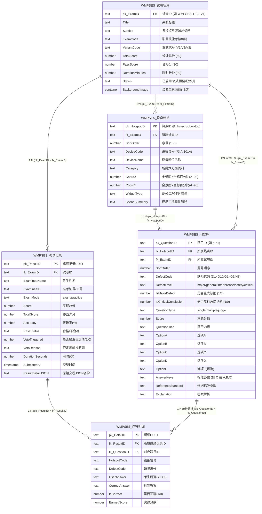

# FileMaker 关系型题库与考务数据库表结构设计手册

为支持在 Claris FileMaker Pro / FileMaker Server 中以真正**关系型表结构**维护“工业废气治理工实操模拟仿真考试系统”的装置场景、图片热点、习题库、考生成绩与逐题作答明细，本手册提供完整的 **5 表关系模型**、**字段定义**、**JSON 实时聚合计算公式**以及 **CSV 一键建表导入指南**。

---

## 一、五表关系架构图（ER Diagram）



---

## 二、逐表字段详细规范

### 表 1：`WMPSES_试卷场景`
> 用途：管理不同考核点（1.1.1、原始启动、泄漏处置）或同考核点的等难度变式（V1/V2/V3）。

| 字段名 | 类型 | 自动输入 / 选项 | 说明 |
| :--- | :--- | :--- | :--- |
| `pk_ExamID` | 文本 | 唯一值、非空（建议 `"WMPSES-1.1.1-V1"` 或 `Get(UUID)`） | 主键 |
| `Title` | 文本 | — | 系统主标题 |
| `Subtitle` | 文本 | — | 副标题（装置说明） |
| `ExamCode` | 文本 | — | 如 `6-28-02-05 / 1.1.1` |
| `VariantCode` | 文本 | 值列表：`V1`, `V2`, `V3` | 变式编号，防相邻两场抽同一套 |
| `TotalScore` | 数字 | 默认 `50` | 试卷规定总分 |
| `PassScore` | 数字 | 默认 `30` | 合格分数线 |
| `DurationMinutes` | 数字 | 默认 `30` | 考试计时时长（分钟） |
| `Status` | 文本 | 值列表：`已启用`, `变式预留`, `已停用` | 状态控制 |
| `Version` | 文本 | 默认 `"1.0.0"` | 题包版本号 |
| `UpdatedAt` | 文本 / 时间戳 | 修改日期自动输入 | 更新日期 |
| `BackgroundImage` | 容器 | — | （可选）全景图备份存储 |
| `c_ActualScoreSum` | 计算（数字） | `Sum ( WMPSES_习题库_按试卷::Score )` | 实时核对各题分值之和是否等于 50 分 |
| `c_FullBankJSON` | 计算（文本） | 见第四节公式 3 | 实时聚合整套题库 JSON 供 WebViewer 加载 |

---

### 表 2：`WMPSES_设备热点`
> 用途：存储全景图上每一个可点击设备的坐标百分比、设备位号与弹窗顶部仿真组件类型。

| 字段名 | 类型 | 自动输入 / 选项 | 说明 |
| :--- | :--- | :--- | :--- |
| `pk_HotspotID` | 文本 | 唯一值、非空 | 主键（如 `hs-scrubber-top`） |
| `fk_ExamID` | 文本 | 索引 | 外键，关联 `WMPSES_试卷场景::pk_ExamID` |
| `SortOrder` | 数字 | 序列号或手动序号 | 展示顺序 `1..8` |
| `DeviceCode` | 文本 | — | 设备位号（如 `A-101A`） |
| `DeviceName` | 文本 | — | 设备部位名称 |
| `Category` | 文本 | — | 所属六方面（如 `润滑冷却系统`） |
| `CoordX` | 数字 | 范围验证 `2..98` | 横向百分比坐标（支持保留 1 位小数） |
| `CoordY` | 数字 | 范围验证 `4..96` | 纵向百分比坐标（支持保留 1 位小数） |
| `WidgetType` | 文本 | 值列表（见下） | `scrubber_top`, `scrubber_bottom`, `induced_fan`, `cooling_water`, `rto_chamber`, `rto_valves`, `cems_stack`, `utilities_plc`, `generic` |
| `SceneSummary` | 文本 | — | 现场可见工况说明 |
| `c_HotspotJSON` | 计算（文本） | 见第四节公式 2 | 实时聚合本热点及下属习题为 JSON 对象 |

---

### 表 3：`WMPSES_习题库`
> 用途：存储各部位关联的单选、多选、判断题。将选项设计为 `OptionA ~ OptionE` 平铺字段，在 FileMaker 布局入口（Portal）中直接编辑极为直观；如需 5 个以上选项可扩展 `OptionF`。

| 字段名 | 类型 | 自动输入 / 选项 | 说明 |
| :--- | :--- | :--- | :--- |
| `pk_QuestionID` | 文本 | 唯一值、非空 | 主键（如 `q-d1`） |
| `fk_HotspotID` | 文本 | 索引 | 外键，关联 `WMPSES_设备热点::pk_HotspotID` |
| `fk_ExamID` | 文本 | 索引（可查表自动填入 `WMPSES_设备热点::fk_ExamID`） | 冗余外键，用于试卷总分统计与 Data API 按卷检索 |
| `SortOrder` | 数字 | — | 部位内题号 `1, 2...` |
| `DefectCode` | 文本 | — | 缺陷编码：`D1`~`D10` / `G1`~`G3` / `N3` / `CONCLUSION` |
| `DefectLevel` | 文本 | 值列表 | `major`(重大), `general`(一般), `interference`(干扰项), `safety`(安全红线), `critical`(总结论) |
| `IsMajorDefect` | 数字 | 布尔 `0` 或 `1` | 计入 N2 否定项“重大缺陷漏判≥3项”统计 |
| `IsCriticalConclusion` | 数字 | 布尔 `0` 或 `1` | 计入 N2 否定项“总体验收误判放行”统计 |
| `QuestionType` | 文本 | 值列表 | `single`(单选), `multiple`(多选), `judge`(判断) |
| `Score` | 数字 | 整数 `1..50` | 本题分值 |
| `QuestionTitle` | 文本 | — | 题干内容 |
| `OptionA` ~ `OptionE` | 文本 | — | 各选项文本内容（空选项自动忽略不生成） |
| `AnswerKeys` | 文本 | — | 正确答案字母，单选用 `C`，多选用英文逗号分隔 `A,B,C` |
| `ReferenceStandard` | 文本 | — | 引用国家/行业标准条款 |
| `Explanation` | 文本 | — | 详细解析 |
| `c_OptionsJSON` | 计算（文本） | 见第四节公式 1a | 自动组装选项数组 |
| `c_AnswerJSON` | 计算（文本） | 见第四节公式 1b | 自动组装答案数组 |
| `c_QuestionJSON` | 计算（文本） | 见第四节公式 1c | 自动组装单题 JSON |

---

### 表 4：`WMPSES_考试记录` & 表 5：`WMPSES_作答明细`

- **`WMPSES_考试记录`** 主表字段：
  - `pk_ResultID`（文本，自动输入 `Get ( UUID )`）
  - `fk_ExamID`（文本，关联 `WMPSES_试卷场景::pk_ExamID`）
  - `ExamineeName`（文本）、`ExamineeID`（文本）、`ExamMode`（文本）
  - `Score`（数字）、`TotalScore`（数字）、`Accuracy`（数字）、`PassStatus`（文本）
  - `VetoTriggered`（数字 `1/0`）、`VetoReason`（文本）
  - `DurationSeconds`（数字）、`SubmittedAt`（时间戳/文本）、`ResultDetailJSON`（文本）
- **`WMPSES_作答明细`** 子表字段：
  - `pk_DetailID`（文本，自动输入 `Get ( UUID )`）
  - `fk_ResultID`（文本，关联 `WMPSES_考试记录::pk_ResultID`，勾选允许级联删除）
  - `fk_QuestionID`（文本，关联 `WMPSES_习题库::pk_QuestionID`）
  - `HotspotCode`（文本）、`DefectCode`（文本）
  - `UserAnswer`（文本）、`CorrectAnswer`（文本）
  - `IsCorrect`（数字 `1/0`）、`EarnedScore`（数字）

---

## 三、关系图设置要点（Relationship Graph）

1. **`WMPSES_试卷场景` ↔ `WMPSES_设备热点`**：
   - 关系条件：`WMPSES_试卷场景::pk_ExamID = WMPSES_设备热点::fk_ExamID`
   - 排序设置：在关系编辑窗口勾选对 `WMPSES_设备热点` 按 **`SortOrder` 升序** 排序。
   - 允许操作：勾选 **允许在此关系中创建/删除记录**。
2. **`WMPSES_设备热点` ↔ `WMPSES_习题库`**：
   - 关系条件：`WMPSES_设备热点::pk_HotspotID = WMPSES_习题库::fk_HotspotID`
   - 排序设置：勾选对 `WMPSES_习题库` 按 **`SortOrder` 升序** 排序。
   - 允许操作：勾选 **允许在此关系中创建/删除记录**。
3. **`WMPSES_试卷场景` ↔ `WMPSES_习题库_按试卷`**（额外表发生器 Table Occurrence）：
   - 关系条件：`WMPSES_试卷场景::pk_ExamID = WMPSES_习题库_按试卷::fk_ExamID`（专门用于 `Sum()` 校验总分及全局统计）。
4. **`WMPSES_考试记录` ↔ `WMPSES_作答明细`**：
   - 关系条件：`WMPSES_考试记录::pk_ResultID = WMPSES_作答明细::fk_ResultID`。

---

## 四、FileMaker JSON 实时聚合计算公式（FileMaker 18+）

> 如果您的数据库使用以下计算字段（均为 **文本类型结果、不存储计算结果**），前端每次打开仅需读取 `WMPSES_试卷场景::c_FullBankJSON` 即可瞬间获得由关系表实时拼接的最新题库！（注：本目录提供的 [加载仿真题库到WebViewer.xml](file:///Users/mac/projects/WMPSES/filemaker_script/加载仿真题库到WebViewer.xml) 也同时支持自动读取或脚本动态遍历组装。）

### 公式 1a：`WMPSES_习题库::c_OptionsJSON`
```text
Let ( [
  j = "[]" ;
  i = 0 ;
  j = If ( not IsEmpty ( OptionA ) ; JSONSetElement ( j ; ["[" & i & "].key" ; "A" ; JSONString] ; ["[" & i & "].text" ; OptionA ; JSONString] ) ; j ) ;
  i = If ( not IsEmpty ( OptionA ) ; i + 1 ; i ) ;
  j = If ( not IsEmpty ( OptionB ) ; JSONSetElement ( j ; ["[" & i & "].key" ; "B" ; JSONString] ; ["[" & i & "].text" ; OptionB ; JSONString] ) ; j ) ;
  i = If ( not IsEmpty ( OptionB ) ; i + 1 ; i ) ;
  j = If ( not IsEmpty ( OptionC ) ; JSONSetElement ( j ; ["[" & i & "].key" ; "C" ; JSONString] ; ["[" & i & "].text" ; OptionC ; JSONString] ) ; j ) ;
  i = If ( not IsEmpty ( OptionC ) ; i + 1 ; i ) ;
  j = If ( not IsEmpty ( OptionD ) ; JSONSetElement ( j ; ["[" & i & "].key" ; "D" ; JSONString] ; ["[" & i & "].text" ; OptionD ; JSONString] ) ; j ) ;
  i = If ( not IsEmpty ( OptionD ) ; i + 1 ; i ) ;
  j = If ( not IsEmpty ( OptionE ) ; JSONSetElement ( j ; ["[" & i & "].key" ; "E" ; JSONString] ; ["[" & i & "].text" ; OptionE ; JSONString] ) ; j )
] ; j )
```

### 公式 1b：`WMPSES_习题库::c_AnswerJSON`
```text
Let ( [
  raw = Trim ( Substitute ( AnswerKeys ; ["，" ; ","] ; [" " ; ""] ) ) ;
  lines = Substitute ( raw ; "," ; ¶ ) ;
  cnt = ValueCount ( lines )
] ;
  While (
    [ idx = 1 ; arr = "[]" ] ;
    idx ≤ cnt ;
    [
      val = GetValue ( lines ; idx ) ;
      arr = If ( not IsEmpty ( val ) ; JSONSetElement ( arr ; "[" & (idx - 1) & "]" ; val ; JSONString ) ; arr ) ;
      idx = idx + 1
    ] ;
    arr
  )
)
```

### 公式 1c：`WMPSES_习题库::c_QuestionJSON`
```text
JSONSetElement ( "{}" ;
  ["id" ; pk_QuestionID ; JSONString] ;
  ["defectCode" ; DefectCode ; JSONString] ;
  ["defectLevel" ; DefectLevel ; JSONString] ;
  ["isMajorDefect" ; GetAsBoolean ( IsMajorDefect ) ; JSONBoolean] ;
  ["isCriticalConclusion" ; GetAsBoolean ( IsCriticalConclusion ) ; JSONBoolean] ;
  ["type" ; QuestionType ; JSONString] ;
  ["score" ; GetAsNumber ( Score ) ; JSONNumber] ;
  ["title" ; QuestionTitle ; JSONString] ;
  ["options" ; c_OptionsJSON ; JSONArray] ;
  ["answer" ; c_AnswerJSON ; JSONArray] ;
  ["referenceStandard" ; ReferenceStandard ; JSONString] ;
  ["explanation" ; Explanation ; JSONString]
)
```

### 公式 2：`WMPSES_设备热点::c_HotspotJSON`
```text
Let ( [
  cnt = Count ( WMPSES_习题库::pk_QuestionID ) ;
  qArr = While (
    [ i = 1 ; arr = "[]" ] ;
    i ≤ cnt ;
    [
      qJson = GetNthRecord ( WMPSES_习题库::c_QuestionJSON ; i ) ;
      arr = JSONSetElement ( arr ; "[" & (i - 1) & "]" ; qJson ; JSONObject ) ;
      i = i + 1
    ] ;
    arr
  )
] ;
  JSONSetElement ( "{}" ;
    ["id" ; pk_HotspotID ; JSONString] ;
    ["order" ; GetAsNumber ( SortOrder ) ; JSONNumber] ;
    ["code" ; DeviceCode ; JSONString] ;
    ["name" ; DeviceName ; JSONString] ;
    ["category" ; Category ; JSONString] ;
    ["x" ; GetAsNumber ( CoordX ) ; JSONNumber] ;
    ["y" ; GetAsNumber ( CoordY ) ; JSONNumber] ;
    ["widgetType" ; WidgetType ; JSONString] ;
    ["sceneSummary" ; SceneSummary ; JSONString] ;
    ["questions" ; qArr ; JSONArray]
  )
)
```

### 公式 3：`WMPSES_试卷场景::c_FullBankJSON`
```text
Let ( [
  meta = JSONSetElement ( "{}" ;
    ["id" ; pk_ExamID ; JSONString] ;
    ["title" ; Title ; JSONString] ;
    ["subtitle" ; Subtitle ; JSONString] ;
    ["examCode" ; ExamCode ; JSONString] ;
    ["totalScore" ; GetAsNumber ( TotalScore ) ; JSONNumber] ;
    ["passScore" ; GetAsNumber ( PassScore ) ; JSONNumber] ;
    ["durationMinutes" ; GetAsNumber ( DurationMinutes ) ; JSONNumber] ;
    ["version" ; Version ; JSONString] ;
    ["updatedAt" ; GetAsText ( UpdatedAt ) ; JSONString]
  ) ;
  cnt = Count ( WMPSES_设备热点::pk_HotspotID ) ;
  hsArr = While (
    [ i = 1 ; arr = "[]" ] ;
    i ≤ cnt ;
    [
      hsJson = GetNthRecord ( WMPSES_设备热点::c_HotspotJSON ; i ) ;
      arr = JSONSetElement ( arr ; "[" & (i - 1) & "]" ; hsJson ; JSONObject ) ;
      i = i + 1
    ] ;
    arr
  )
] ;
  JSONSetElement ( "{}" ;
    ["meta" ; meta ; JSONObject] ;
    ["hotspots" ; hsArr ; JSONArray]
  )
)
```

---

## 五、3 分钟快速建表操作指南（导入种子 CSV）

在您新建的 FileMaker 数据库（例如 `WMPSES_Exam.fmp12`）中，无需手动一个个敲字段名，直接利用 `filemaker_script/seed_data/` 下的 3 个 CSV 文件即可一键生成表结构并灌入全部 8 个热点、15 道题：

1. **导入表 1**：在 FileMaker Pro 菜单点击 `文件 -> 导入记录 -> 文件...`，选择 `seed_data/1_WMPSES_试卷场景.csv`：
   - 将“目标”下拉框选为 **新建表（`WMPSES_试卷场景`）**；
   - 勾选 **“不要导入第一条记录（使用作字段名称）”**，完成导入（导入 3 条试卷场景记录）。
2. **导入表 2**：再次 `导入记录 -> 文件...`，选择 `seed_data/2_WMPSES_设备热点.csv`，目标选 **新建表（`WMPSES_设备热点`）**（导入 8 个热点）。
3. **导入表 3**：再次 `导入记录 -> 文件...`，选择 `seed_data/3_WMPSES_习题库.csv`，目标选 **新建表（`WMPSES_习题库`）**（导入 15 道题目）。
4. **手动补充表 4 & 表 5**：在“管理数据库”中新建 `WMPSES_考试记录` 和 `WMPSES_作答明细` 两张表，并按第三节建立关系连接。
5. **配置计算字段与布局**：在表 1/2/3 中添加第四节的计算字段（或直接使用本目录提供的关系型循环脚本），在考试布局中放置名称为 `wv_exam` 的 WebViewer 即可！
