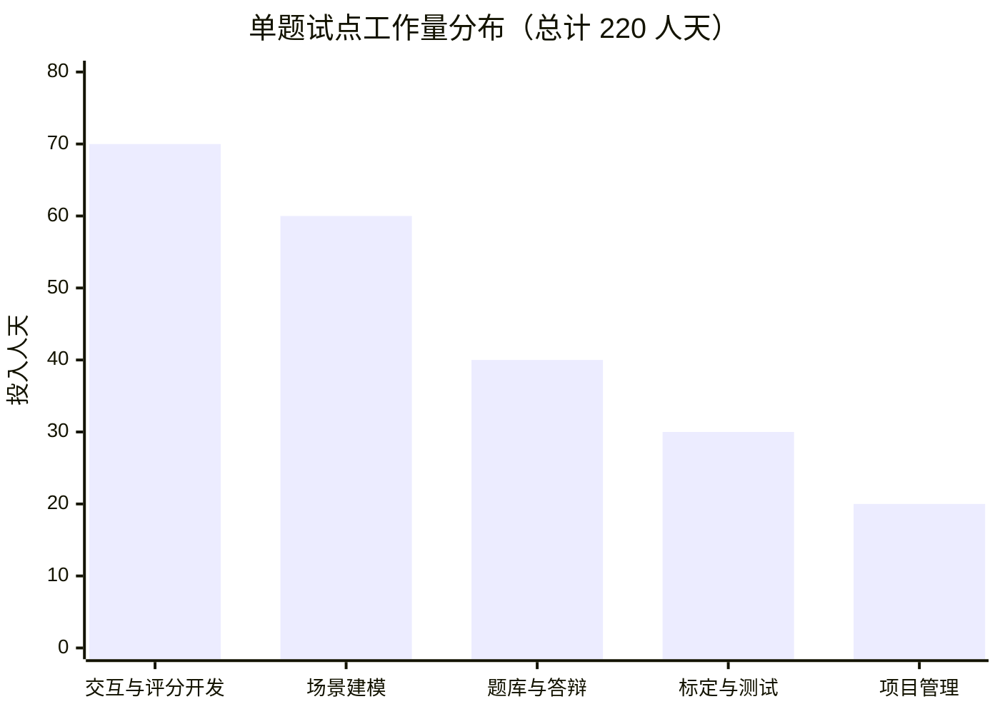
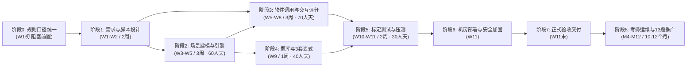

# 工业废气治理工实操模拟仿真考试系统（1.1.1 设备验收）全周期任务清单与甘特图

> **编写依据**：[启动前设备验收仿真考试系统介绍 (1).pdf](file:///Users/mac/projects/WMPSES/%E5%90%AF%E5%8A%A8%E5%89%8D%E8%AE%BE%E5%A4%87%E9%AA%8C%E6%94%B6%E4%BB%BF%E7%9C%9F%E8%80%83%E8%AF%95%E7%B3%BB%E7%BB%9F%E4%BB%8B%E7%BB%8D%20(1).pdf) 与 [废气治理工技师实操仿真考试系统设计方案（设备验收1.1.1）.docx](file:///Users/mac/projects/WMPSES/%E5%BA%9F%E6%B0%94%E6%B2%BB%E7%90%86%E5%B7%A5%E6%8A%80%E5%B8%88%E5%AE%9E%E6%93%8D%E4%BB%BF%E7%9C%9F%E8%80%83%E8%AF%95%E7%B3%BB%E7%BB%9F%E8%AE%BE%E8%AE%A1%E6%96%B9%E6%A1%88%EF%BC%88%E8%AE%BE%E5%A4%87%E9%AA%8C%E6%94%B61.1.1%EF%BC%89.docx)
> **交互式看板**：可直接双击打开项目根目录下的 [gantt-roadmap.html](file:///Users/mac/projects/WMPSES/gantt-roadmap.html) 查看可勾选、可筛选、可导出 CSV 的可视化甘特图。

---

## 一、项目总体排期与工作量概览

| 建设阶段范围 | 工期 | 估算工作量 | 核心策略 |
| :--- | :--- | :--- | :--- |
| **第一阶段：1.1.1 单题试点建设** | **11 周**（约 2.5 个月） | **220 人天** | 统一度量口径 → 搭建底座（引擎+工作台+评分）→ 30份样本标定交付 |
| **第二阶段：全套 13 道实操题推广** | **10 ~ 12 个月** | 每题增量 **60 ~ 80 人天** | 复用场景引擎、确认单与评分框架，分三批建设其余 12 题（共13题） |

### 单题试点 220 人天资源分配

---

## 二、甘特图与阶段依赖关系

### 2.1 阶段依赖与关键路径图

### 2.2 单题试点甘特图（W1 ~ W11 周粒度进度条）

| 阶段 / 任务模块 | W1 | W2 | W3 | W4 | W5 | W6 | W7 | W8 | W9 | W10 | W11 | 工期 | 里程碑交付物 |
| :--- | :-: | :-: | :-: | :-: | :-: | :-: | :-: | :-: | :-: | :-: | :-: | :--- | :--- |
| **阶段0：实施前规则校准与统一** | ██ | · | · | · | · | · | · | · | · | · | · | 0.5周 | 统一口径纪要（解决3项冲突） |
| **阶段1：需求解构与脚本设计** | ██ | ██ | · | · | · | · | · | · | · | · | · | 2周 | 场景脚本、缺陷库、评分规则初稿 |
| **阶段2：三维建模与仿真引擎** | · | · | ██ | ██ | ██ | · | · | · | · | · | · | 3周 | 场景包V1、模型验证记录 |
| **阶段3：软件调用、交互与评分开发** | · | · | · | · | ▒▒ | ██ | ██ | ██ | · | · | · | 3周 | 接口联调、工作台、系统功能V1 |
| **阶段4：题库与三套等难度变式** | · | · | · | · | · | · | · | · | ██ | · | · | 1周 | 题包V1(V1/V2/V3)、答辩题库 |
| **阶段5：样本标定与并发测试** | · | · | · | · | · | · | · | · | · | ██ | ██ | 2周 | 30样本标定报告、性能测试报告 |
| **阶段6：软硬件部署与等保加固** | · | · | · | · | · | · | · | · | · | ▒▒ | ██ | 1周 | 30路考场部署与断网断电演练 |
| **阶段7：八项指标正式验收交付** | · | · | · | · | · | · | · | · | · | · | ██ | 收官 | 验收签字报告、归档移交 |
| *项目管理（贯穿全周期 / 20人天）* | ▓▓ | ▓▓ | ▓▓ | ▓▓ | ▓▓ | ▓▓ | ▓▓ | ▓▓ | ▓▓ | ▓▓ | ▓▓ | 11周 | 周报、风险台账、变更记录 |

> 图例：`██` 核心主线实施 ｜ `▒▒` 提前并行介入 / 联调准备 ｜ `▓▓` 贯穿管理任务

### 2.3 全套 13 道题三批推广甘特图（M1 ~ M12 月度规划）

| 批次与建设范围 | M1 | M2 | M3 | M4 | M5 | M6 | M7 | M8 | M9 | M10 | M11 | M12 | 说明 |
| :--- | :-: | :-: | :-: | :-: | :-: | :-: | :-: | :-: | :-: | :-: | :-: | :-: | :--- |
| **试点：1.1.1 启动前设备验收（50分）** | ██ | ██ | ██ | · | · | · | · | · | · | · | · | · | 11周完成底座搭建与标定 |
| **第一批：核心启动与事故（3道50分题）** | · | · | ▒▒ | ██ | ██ | ██ | · | · | · | · | · | · | 含“原始启动”（复用碱洗+RTO）、“泄漏事故处置” |
| **第二批：专项操作（6道25分题）** | · | · | · | · | · | ▒▒ | ██ | ██ | ██ | · | · | · | 清洗吹扫置换、联锁检查、报警优化等 |
| **第三批：收尾与辅助（4道剩余题）** | · | · | · | · | · | · | · | · | ▒▒ | ██ | ██ | ██ | 停运、保护验收、事故后续处置等 |
| **常态化考务运维与标准年度复核** | · | · | · | ▓▓ | ▓▓ | ▓▓ | ▓▓ | ▓▓ | ▓▓ | ▓▓ | ▓▓ | ▓▓ | 考务抽卷、题库加密与国标同步更新 |

---

## 三、全阶段详细待做任务清单（WBS Checklist）

### 阶段 0：实施前规则校准与口径统一（W1 初｜前置阻塞项）

> [!WARNING]
> 本阶段任务必须在编码与脚本定稿前由工艺专家、安全专家与考务命题组签字拍板（对应 PDF 第 15 页“实施前统一”）。

- [ ] **0.1 解决“重大缺陷六方面覆盖”与清单不一致问题**
  - 原方案表2中，D2（油位乳化）与 D3（冷却水未投用）同属润滑冷却系统，而“公用工程配套”未单独分配重大缺陷；需明确是否将 1 项公用工程异常升级为重大缺陷，或调整第 15 条采分点规则口径。
- [ ] **0.2 统一“整数计分原则”与“1.5分扣分”冲突**
  - 设计原则明确“单点分值取 1~3 分，不设 0.5 分”，但表8第 24、25 题答辩评分标准写明“缺 1 类/1 个扣 1.5 分”；需统一改为整数扣分梯度（例如 5/3/2/0 分）或明确允许小数计算。
- [ ] **0.3 统一计时起点、超时与断网缓存口径**
  - 确认“方案编制 3 分钟 + 现场核查 17 分钟 = 20 分钟”与 N1“操作阶段超过 25 分钟仍未提交记 0 分”之间的 5 分钟阶梯扣分规则（每超1分钟扣1分、最多扣5分）；确认断网本地缓存重连机制的计时冻结边界。
- [ ] **0.4 审定新增否定项 N3（受限空间作业红线）**
  - 将“未完成气体分析/盲板隔离/审批/监护即进入塔内或炉内检查触发中毒窒息 0 分”报命题组正式审定入库。

---

### 阶段 1：教学设计与需求脚本编制（W1 ~ W2｜2 周）

- [ ] **1.1 五项考核要求仿真化拆解**
  - 落实“查得到、判得准、处置对、留得下”四目标，将原纯选择题四个选项改造为确认单的“判定结果 + 判定依据库”联动选取，保留纯条文记忆转入答辩题。
- [ ] **1.2 编制“六方面 · 24 项”验收确认单与判定依据库**
  - 完成《附录A》24 项核查项的“合格 / 不合格 / 待复测”标准答案及对应标准条文库（引用 GB 37822-2019、HJ 75-2017、HJ 76-2017、HJ 2000-2018、GB 30871-2022 等）。
- [ ] **1.3 设计 13 项基准场景缺陷与干扰项脚本**
  - 6 项重大缺陷（D1 防腐脱落、D2 油位低乳化、D3 冷却水假压力未投用、D4 气源不足切换迟滞、D5 报警仪标定态+CEMS漂移超期、D6 液位联锁旁路+引压管堵塞假指示）。
  - 4 项一般缺陷（D7 法兰缺2条螺栓、D8 压力表标签过期15天、D9 平台护栏横杆变形、D10 铭牌色标污损）。
  - 3 项干扰项（G1 油位低限上方5mm、G2 回水温度45℃≤50℃、G3 CEMS量程与环评一致但异于铭牌）。
- [ ] **1.4 编写四份配套电子工况资料（确保三处一致）**
  - 编写《检修记录》《设备台账》《上次验收报告》《CEMS校验记录》，严格校验“三维/界面贴图、仪表参数、台账文档”三处描述零矛盾。
- [ ] **1.5 制定《基准卷采分点明细表》（25 个采分点，共 50 分）**
  - 固化 S 类（操作序列点）、P 类（参数判定点）、K 类（知识表达点）规则，明确覆盖分（查了没有）与判定分（判对没有）分离机制，确保不按点击次数或停留时长计分。

---

### 阶段 2：三维/全景场景建模与仿真引擎开发（W3 ~ W5｜3 周 · 60 人天）

- [ ] **2.1 装置三维/2D可视化场景构建与走动成本控制**
  - 构建“碱洗预处理＋三室蓄热式焚烧（RTO）”联合装置（不含储罐区与厂界）。
  - 压缩巡检路径在约 120 米内，设置 **5 个快速传送点**（中控室、塔底、塔顶平台、风机区、RTO框架），确保任一缺陷发现距离 ≤ 2 次点击。
- [ ] **2.2 建立 4 大核心工艺机理动态模型**
  - 碱洗塔压降—风量关系与填料段传质效率模型；
  - RTO 三室蓄热体温度分布与切换周期模型；
  - 冷却水系统换热量与供回水温度模型；
  - 引风机与助燃风机功率—风量曲线模型。
  - **精度要求**：仿真步长 ≤ 1s，稳态参数与设计值偏差 ≤ 5%，动态响应与实装置一致（如气源 0.32MPa 时切换阀全行程由 3s 延长至 9s）。
- [ ] **2.3 实现 5 类设备状态机**
  - 覆盖泵、风机、阀门（开度连续可调）、仪表（支持零点漂移、响应滞后、假指示）、联锁（投用/旁路/失效三种状态），支持“停止—启动—运行—故障—跳车”迁移。
- [ ] **2.4 开发缺陷动态注入引擎**
  - 将缺陷绑定为设备对象属性而非静态死贴图（修复或复测后状态动态响应变化）；实现同类设备间随机分配缺陷与合格区间 ±5% 随机浮动。
- [ ] **2.5 完成模型静态与动态验证**
  - 输出《场景包 V1》及《工艺模型稳态/动态验证记录》。

---

### 阶段 3：软件调用、交互界面与评分考务开发（W5 ~ W8｜3 周 · 70 人天）

#### 3.1 软件调用与数据接口集成（API / Bridge）
- [ ] **仿真层与评分层事件总线调用**：定义标准化 JSON 事件流协议（`timestamp`、`examineeId`、`deviceCode`、`actionType`、`oldValue`、`newValue`），彻底解耦仿真运算与算分规则。
- [ ] **考试时钟与场景冻结服务调用**：实现“阅题 5min / 编方案 3min / 核查 17min / 答辩 5min”时间轴统一控制；在阅题与答辩阶段调用引擎 `freezeScene()` 接口冻结现场操作。
- [ ] **外部数据库/题库平台接口调用（FileMaker / REST）**：
  - WebViewer 双向脚本调用：`FileMaker.PerformScriptWithOption` 回传成绩与题库配置，暴露 `FMExam.loadQuestionBank`、`FMExam.setStudentInfo`、`FMExam.getExamResultJSON` 供宿主调用；
  - FileMaker Data API 接口调用：`POST /sessions` 鉴权、`GET /layouts/{layout}/records` 拉取题库、`POST /layouts/{layout}/records` 写入成绩；
  - 断线/断网断点续考同步接口：本地缓存操作事件与答题状态，断线恢复后双向校验重传。
- [ ] **答辩录音与音视频采集组件调用**：对接麦克风录音 API，录存考生 2 道答辩题（每题 2.5 分钟）音频并关联考评员打分表单。
- [ ] **（可选高精度扩展）OTS 外部仿真接口预留**：若采用西门子 SIMIT + gPROMS 方案，完成 gFPI（OPC UA）信号点表 JSON 映射与 PLCSIM Advanced PROFINET 仿真耦合联调。

#### 3.2 前端交互层与验收工作台开发
- [ ] **第一人称三维巡检 / 2D全景热点交互**：实现环绕巡视、仪表标签放大至可读、就地动作交互（手轮查看、阀门动作测试、取油样、测厚/测振/测温、便携式气体检测仪、灭火器/洗眼器检查）。
- [ ] **DCS 中控与公用工程监控画面**：还原 LT-101 液位、冷却水流量趋势、联锁投用/旁路画面、公用工程压缩空气/氮气/双回路供电画面。
- [ ] **四页签验收工作台**：
  1. **确认单页签**：24 项逐项判定 + 依据选取，支持点击某一项**双向传送**至对应设备；
  2. **缺陷登记页签**：填写位置、描述、级别、可能后果；
  3. **拍照取证页签**：现场截图并自动关联设备位号与三维/平面坐标；
  4. **结论与移交页签**：总体放行判定、处置意见、复验要求、电子签字与台账生成。

#### 3.3 评分引擎与监考端开发
- [ ] **自动采分规则引擎**：实现 40 分操作分（准备 3 + 六方面核查 24 + 缺陷识别 6 + 判定处置 3 + 记录移交 4）自动判定，并与 10 分人工答辩分合成总分。
- [ ] **否定项强制硬约束与“三证”留痕**：系统自动校验 N1/N2/N3 触发条件；触发瞬间立即锁定答卷并抓取“带时间戳操作日志 + 触发时场景截图 + 参数快照”三件证据归档。
- [ ] **监考端软件开发**：按 1:15 监考配置，只展示考生位置、已查项数、已登记缺陷数与剩余时间（隐藏答案防提示），支持一键冻结与异常处理补时。

---

### 阶段 4：题库封装与等难度变式建设（W9｜1 周 · 40 人天）

- [ ] **4.1 封装 8 要素标准题包结构**
  - 含题干与要求、4 份工况资料、场景包、确认单、缺陷库与判定标准、采分规则、参考答案与细则、答辩题库，实施版本号管理。
- [ ] **4.2 制作 3 套等难度变式题包（防背题）**
  - **V1 基准卷**：碱洗＋RTO（6重大+4一般+3干扰）；
  - **V2 换卷**：活性炭吸附＋催化燃烧（吸附箱腐蚀、脱附加热器超温、催化床压差高、氮封压力不足、温传漂移、风机轴承温高）；
  - **V3 换卷**：湿式洗涤＋生物滤池（喷嘴堵塞、填料板结、泵机封渗漏、滤池湿度不足、除雾器破损、风量分配不均）。
- [ ] **4.3 编写每套变式 ≥ 10 道答辩题及评分要点**
  - 确保抽取题目不与考生在场景中已登记的缺陷简单重复。
- [ ] **4.4 完成“两编三审一试做”**
  - 工艺+安全各 1 人命题 → 3 名专家审查（标准符合性、现场真实性、评分可操作性）→ 1 名试做人全真试做，校准耗时落在 **14 ~ 22 分钟**区间。

---

### 阶段 5：标定测试与性能压测（W10 ~ W11｜2 周 · 30 人天）

- [ ] **5.1 可考性与路径开放性验证（专家试做）**
  - 验证 10 项缺陷均可通过 **≥ 2 条交互路径**发现，无“靠猜”缺陷；
  - 3 名专家独立试做比对，验证完成全流程的合理操作路径 **≥ 3 条**且不因路径差异扣分。
- [ ] **5.2 评分一致性标定（30 份样本双评）**
  - 抽取 30 份不同水平作答样本，由 3 名持证考评员独立双评，校准至 **加权 Kappa ≥ 0.75**、同一答卷评分偏差 **≤ 3 分**、极差 **≤ 5 分**；消除干扰项与处置意见争议。
- [ ] **5.3 并发与响应性能压测**
  - 30 路终端并发作答压测：界面响应 **≤ 200ms**，场景初始加载 **≤ 60s**，快速传送 **≤ 10s**。
- [ ] **5.4 日志完整性与故障恢复演练**
  - 随机抽查 20 份答卷验证交互/判定/缺陷/照片 **100% 留痕**；
  - 执行断网与断电实操演练，验证 **≤ 5 分钟**恢复至最近节点且已采分不丢失。

---

### 阶段 6：软硬件部署与信息安全加固（W11）

- [ ] **6.1 考点局域网硬件与网络部署**
  - 部署 1 台图形服务器 + 2 台业务服务器（考务/数据库）+ 30 台考场终端（配独显或云渲染瘦终端：带宽 ≥ 20Mbps，时延 ≤ 50ms），配置双链路千兆网与维持 ≥ 30 分钟的独立 UPS。
- [ ] **6.2 考试终端环境锁死与保密加固**
  - 禁用外网连接、禁用 USB 存储与截屏热键，配置作答数据实时回传服务器、不在终端本地明文留存。
- [ ] **6.3 题库加密与等保二级测评**
  - 落实题库加密存储、抽题日志审计、命题与考评人员权限隔离，通过 **GB/T 22239-2019 网络安全等级保护二级**第三方测评。

---

### 阶段 7：项目正式验收与交付（W11 末）

- [ ] **7.1 逐项核验表 10 八项交付验收指标**
  - 确认缺陷可发现性、路径开放性、评分一致性、并发性能、加载与切换速度、日志完整性、故障恢复、安全合规全部达标。
- [ ] **7.2 交付全套资产清单**
  - 交付安装包与源码、题包 V1（含 3 套变式）、30 样本标定报告、性能与等保测评报告、系统运维与考务操作手册，完成三方签字归档。

---

### 阶段 8：考务运维与全套 13 题分批推广（M4 ~ M12｜长期）

- [ ] **8.1 考务组织与异常四类预案运维**
  - 落实终端故障（10min 换机续考）、网络中断（本地缓存校验）、模型异常（监考端冻结判定）、考生不适（中止封存）四类异常记录归档；严格执行同考点连续两场不重复使用同一变式。
- [ ] **8.2 年度标准合规与题库滚动维护**
  - 每年定期复核一次；当 GB 30871、HJ 75/76、GB 37822 等引用国标/行标修订时，**即时修订判定依据与阈值**并同步升级题包版本号。
- [ ] **8.3 复用底座推进其余 12 道实操题分批建设（每题 60~80 人天）**
  - **第一批（3 道 50 分题）**：1.1.1（本题）+“原始启动”（共享碱洗+RTO 场景摊薄成本）+“泄漏事故处置”；
  - **第二批（6 道 25 分题）**：清洗吹扫置换、联锁检查、报警优化等专项操作题；
  - **第三批（4 道剩余题）**：停运、保护验收、事故后续处置等，全部建成预计 **10~12 个月**。
