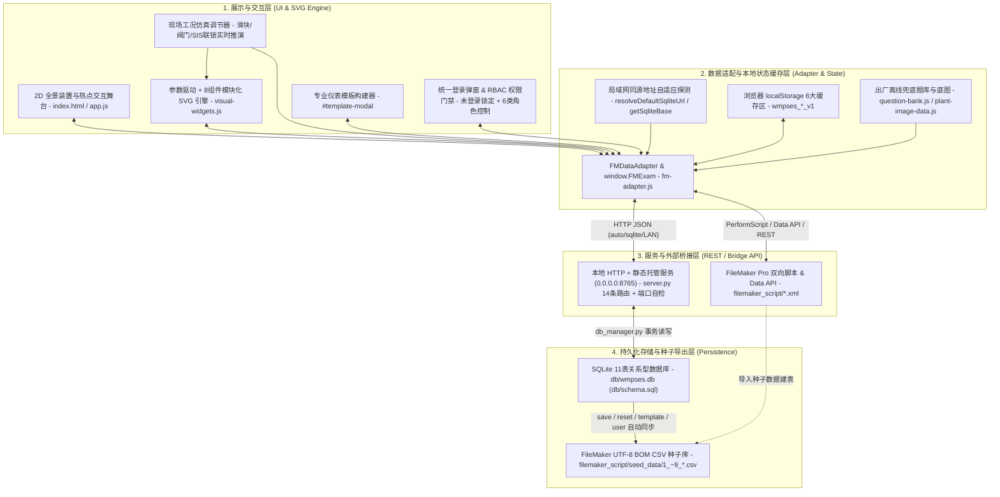
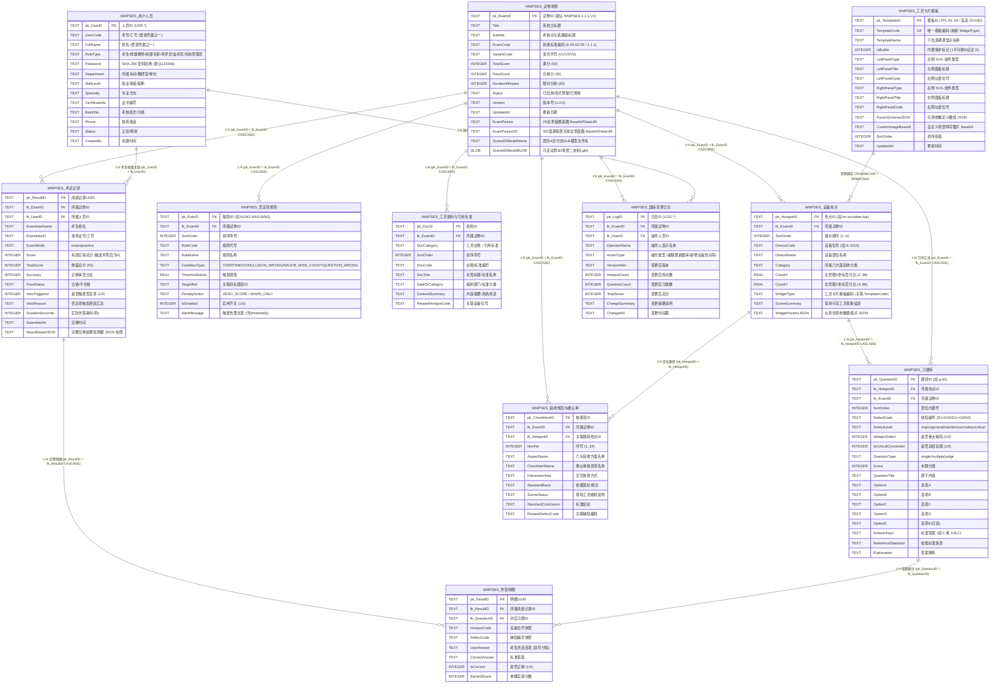
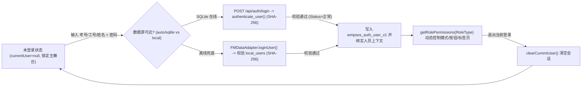
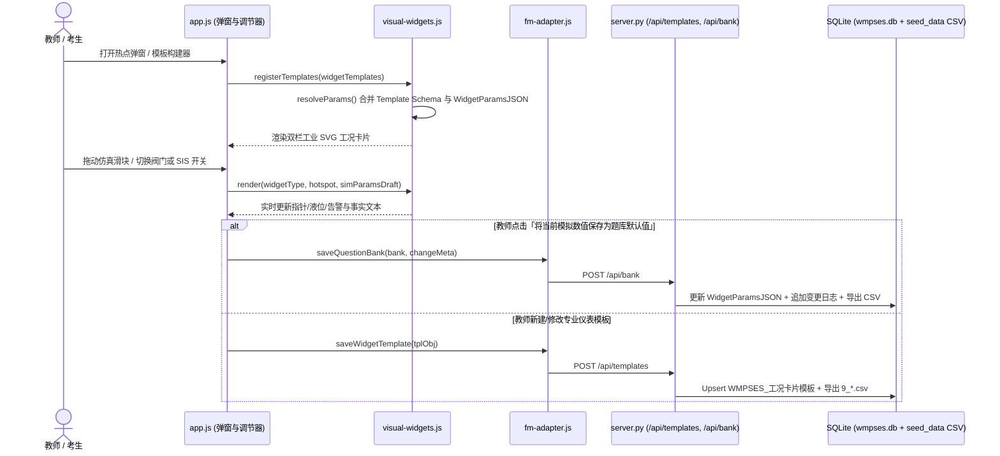
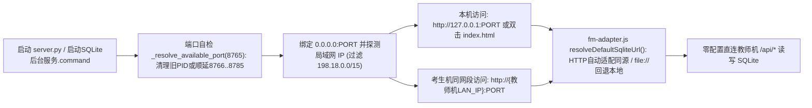

# WMPSES - 工业废气治理工实操模拟仿真考试系统数据逻辑视图

> 本文档对应系统当前 **SQLite 11 表关系型架构 + 局域网/多端数据适配层 + 动态 SVG 工况仿真引擎 + RBAC 人员鉴权体系**，所有实体、字段、索引、接口与数据流均与 [schema.sql](db/schema.sql)、[db_manager.py](db/db_manager.py)、[server.py](server.py)、[fm-adapter.js](js/fm-adapter.js)、[visual-widgets.js](js/visual-widgets.js) 及 [app.js](js/app.js) 保持 1:1 严格一致。

---

## 一、总体数据逻辑分层架构图



---

## 二、SQLite / FileMaker 11 表全局实体关系图（ER Diagram）



---

## 三、四大业务数据域与 11 表逻辑字典明细

### 域 1：核心试卷场景与热点题库域

| 表名 | 主键 / 约束 | 索引 | 核心职责与 JSON 扩展字段说明 | 对应种子 CSV |
| :--- | :--- | :--- | :--- | :--- |
| `WMPSES_试卷场景` | `pk_ExamID` (PK) | rowid 顺序 | 管理试卷元信息、总分/合格线/限时、`ExamPicture`（2D装置底图）与 `ExamPicture3D`（3D/漫游等距天球底图 Base64） | `1_WMPSES_试卷场景.csv`（3 条） |
| `WMPSES_设备热点` | `pk_HotspotID` (PK)<br>`fk_ExamID` -> `WMPSES_试卷场景` (`CASCADE`) | `idx_hotspots_exam_order` (`fk_ExamID`, `SortOrder`) | 存储装置图百分比坐标 (`CoordX`/`CoordY`)、关联模板 `WidgetType` 及仪表初始数值 `WidgetParamsJSON` | `2_WMPSES_设备热点.csv`（8 条） |
| `WMPSES_习题库` | `pk_QuestionID` (PK)<br>`fk_HotspotID` -> `WMPSES_设备热点` (`CASCADE`)<br>`fk_ExamID` -> `WMPSES_试卷场景` (`CASCADE`) | `idx_questions_hotspot_order` (`fk_HotspotID`, `SortOrder`)<br>`idx_questions_exam` (`fk_ExamID`) | 存储题型 (`single`/`multiple`/`judge`)、`OptionA`~`E`、`AnswerKeys`、分值、`DefectCode`/`DefectLevel` 及 `IsMajorDefect`/`IsCriticalConclusion` | `3_WMPSES_习题库.csv`（15 条，50 分） |

### 域 2：SVG 仪表模板与现场工况仿真域

| 表名 | 主键 / 约束 | 索引 | 核心职责与 JSON 扩展字段说明 | 对应种子 CSV |
| :--- | :--- | :--- | :--- | :--- |
| `WMPSES_工况卡片模板` | `pk_TemplateID` (PK)<br>`TemplateCode` (`UNIQUE`) | `idx_widget_templates_order` (`IsBuiltin` DESC, `SortOrder` ASC) | 存储 9 套内置模板（`TPL-01`~`TPL-09`）及教师自定义组合模板。`LeftPanelType`/`RightPanelType` 对应 `visual-widgets.js` 中 8 类组件；`ParamSchemaJSON` 定义滑块/下拉/文本参数项；`CustomImageBase64` 存储局部特写照片 | `9_WMPSES_工况卡片模板.csv`（9 条） |

**8 类可组合 SVG 面板组件（`PANEL_COMPONENT_TYPES`）逻辑映射**：
- `gauge_dial`（圆形指针压力/真空表）
- `pipe_valve_flow`（工艺管线 + 阀门 + 数字流量计）
- `sight_glass`（立式液位计 / 轴承油标视镜）
- `dcs_interlock`（DCS / SIS 联锁与参数趋势看板）
- `flange_bolts`（圆形法兰螺栓紧固检查盘）
- `cert_nameplate`（强检合格证与设备铭牌色标卡）
- `gas_cems_alarm`（气体报警仪 / CEMS 诊断面板）
- `custom_image_card`（自定义上传现场特写图 + 读数角标）

### 域 3：表驱动否定项与标准规范参考域

| 表名 | 主键 / 约束 | 索引 | 核心职责与动态判定逻辑 | 对应种子 CSV |
| :--- | :--- | :--- | :--- | :--- |
| `WMPSES_否定项规则` | `pk_RuleID` (PK)<br>`fk_ExamID` -> `WMPSES_试卷场景` (`CASCADE`) | `idx_veto_rules_exam` (`fk_ExamID`, `SortOrder`) | 配置一票否决/告警规则，支持 `ConditionType`：`OVERTIME`（N1 超时）、`CONCLUSION_WRONG`（N2-A 总结论错）、`MAJOR_MISS_COUNT`（N2-B 重大缺陷漏判计数）、`QUESTION_WRONG`（N3 受限空间安全红线），`PenaltyAction` 为 `ZERO_SCORE` 或 `WARN_ONLY` | `4_WMPSES_否定项规则.csv`（4 条） |
| `WMPSES_验收规范与确认单` | `pk_CheckItemID` (PK)<br>`fk_ExamID` -> `WMPSES_试卷场景` (`CASCADE`) | `idx_checklist_exam_no` (`fk_ExamID`, `ItemNo`) | 收录 6 大方面 24 项设备验收核查单，通过 `fk_HotspotID` 支持在「📋 台账与验收方案」弹窗点击「前往」直达对应热点 | `5_WMPSES_验收规范与确认单.csv`（24 条） |
| `WMPSES_工况资料与引用标准` | `pk_DocID` (PK)<br>`fk_ExamID` -> `WMPSES_试卷场景` (`CASCADE`) | `idx_docs_exam_cat` (`fk_ExamID`, `DocCategory`, `SortOrder`) | 按 `DocCategory` 区分「工况台账」（4 份现场台账）与「引用标准」（14 部附录 C 引用国标） | `6_WMPSES_工况资料与引用标准.csv`（18 条） |

### 域 4：统一人员认证、考务成绩与审计留痕域

| 表名 | 主键 / 约束 | 索引 | 核心职责与记录生命周期 | 对应种子 CSV |
| :--- | :--- | :--- | :--- | :--- |
| `WMPSES_用户人员` | `pk_UserID` (PK) | `idx_users_role_code` (`RoleType`, `UserCode`) | 单表统一管理 **考生、命题教师、审题专家、考评员、监考员、系统管理员**，`Password` 采用 SHA-256 哈希加密（初始 `123456`） | `7_WMPSES_用户人员.csv`（8 条） |
| `WMPSES_考试记录` | `pk_ResultID` (PK)<br>`fk_ExamID` -> `WMPSES_试卷场景` (`CASCADE`) | `idx_results_submitted` (`SubmittedAt` DESC) | 记录每次正式交卷主档案（绑定 `fk_UserID`、有效得分、耗时、合格状态、是否一票否决及 `ResultDetailJSON`） | 运行态考务表（不导出种子 CSV） |
| `WMPSES_作答明细` | `pk_DetailID` (PK)<br>`fk_ResultID` -> `WMPSES_考试记录` (`CASCADE`) | `idx_details_result` (`fk_ResultID`) | 记录单次交卷下全部 15 道题目的 `UserAnswer`、`CorrectAnswer`、`IsCorrect` 与 `EarnedScore` | 运行态考务表（不导出种子 CSV） |
| `WMPSES_题库变更日志` | `pk_LogID` (PK)<br>`fk_ExamID` -> `WMPSES_试卷场景` (`CASCADE`) | `idx_changelog_exam_time` (`fk_ExamID`, `ChangedAt` DESC) | 自动记录教师拖拽热点、新增热点、修改题目、调节基准参数、更换底图与否定项规则变更快照 | `8_WMPSES_题库变更日志.csv`（初始化 2 条 + 动态追加） |

---

## 四、核心业务数据流与状态流转

### 1. 统一登录认证、本地存储键与 RBAC 权限门禁流



**浏览器 `localStorage` 缓存键值规划（`STORAGE_KEYS`）**：
- `wmpses_question_bank_v1`：当前激活题库聚合对象缓存
- `wmpses_fm_config_v1`：数据源模式、`sqliteApiUrl`、FileMaker 脚本/Data API 配置及当前考生上下文
- `wmpses_exam_history_v1`：最近 20 条本地交卷成绩历史快照
- `wmpses_auth_user_v1`：当前已登录人员会话（已脱敏，不含明文/哈希密码字段）
- `wmpses_local_users_v1`：离线兜底人员档案与修改后的密码哈希缓存
- `wmpses_widget_templates_v1`：专业仪表模板库本地同步缓存

### 2. SVG 仪表模板渲染与工况参数实时仿真流



### 3. 正式考试交卷与表驱动否定项（N1~N3）判分流

```mermaid
flowchart TB
    Submit["考生点击交卷 / 30分钟倒计时结束"] --> LoopQ["遍历全部热点下属习题 并比对 state.answers 与 AnswerKeys"]
    LoopQ --> RawScore["计算卷面累计得分 earnedScore 与重大缺陷漏判数"]
    RawScore --> VetoEngine["表驱动否定项规则引擎: 读取 WMPSES_否定项规则 (IsEnabled=1)"]

    VetoEngine --> CheckN1{"ConditionType == OVERTIME (耗时 > 阈值分钟)"}
    VetoEngine --> CheckN2A{"ConditionType == CONCLUSION_WRONG (总结论题错/未答)"}
    VetoEngine --> CheckN2B{"ConditionType == MAJOR_MISS_COUNT (重大缺陷漏错 >= 阈值)"}
    VetoEngine --> CheckN3{"ConditionType == QUESTION_WRONG (红线指定题错/未答)"}

    CheckN1 -->|是| RuleHit["记录 triggeredRules[] 与 vetoReasons[]"]
    CheckN2A -->|是| RuleHit
    CheckN2B -->|是| RuleHit
    CheckN3 -->|是| RuleHit

    RuleHit --> ActionCheck{"命中规则含 PenaltyAction == ZERO_SCORE?"}
    CheckN1 -->|未命中| CalcPass
    CheckN2A -->|未命中| CalcPass
    CheckN2B -->|未命中| CalcPass
    CheckN3 -->|未命中| CalcPass
    ActionCheck -->|是| ZeroOut["effectiveScore = 0, passed = false (一票否决)"]
    ActionCheck -->|否 (WARN_ONLY)| CalcPass["effectiveScore = earnedScore, passed = 达标线判定"]

    ZeroOut --> PersistResult["POST /api/results 写入 WMPSES_考试记录 + WMPSES_作答明细 + 本地历史"]
    CalcPass --> PersistResult
```

### 4. 局域网多机访问与同源地址自适应逻辑



---

## 五、前后端聚合 JSON 数据契约（`/api/bank` 输出映射）

当客户端请求 `GET /api/bank` 或调用 `FMDataAdapter.loadQuestionBank()` 时，后端 [db_manager.py](db/db_manager.py) 的 `get_question_bank()` 将分散在关系表中的数据按如下逻辑契约聚合下发：

```json
{
  "meta": {
    "id": "WMPSES-1.1.1-V1",
    "title": "工业废气治理工（二级/技师）实操模拟仿真考试系统",
    "subtitle": "1.1.1 系统启动前设备验收（碱洗预处理＋三室RTO联合装置）",
    "examCode": "6-28-02-05 / 1.1.1",
    "totalScore": 50,
    "passScore": 30,
    "durationMinutes": 30,
    "version": "1.0.0",
    "updatedAt": "2026-11-19",
    "examPicture": "data:image/jpeg;base64,..."
  },
  "hotspots": [
    {
      "id": "hs-scrubber-top",
      "order": 1,
      "code": "A-101A",
      "name": "碱洗塔上部与塔顶平台",
      "category": "设备本体外观 / 监测仪表",
      "x": 23.2,
      "y": 32.5,
      "widgetType": "scrubber_top",
      "widgetParams": { "peelArea": 0.3, "topPressure": 0.15, "expiredDays": 15 },
      "sceneSummary": "...",
      "questions": [
        {
          "id": "q-d1",
          "defectCode": "D1",
          "defectLevel": "major",
          "isMajorDefect": true,
          "isCriticalConclusion": false,
          "type": "single",
          "score": 4,
          "title": "...",
          "options": [{ "key": "A", "text": "..." }],
          "answer": ["C"],
          "referenceStandard": "...",
          "explanation": "..."
        }
      ]
    }
  ],
  "vetoRules": [
    {
      "id": "N1",
      "order": 1,
      "code": "N1",
      "name": "超时未完成交卷判定",
      "conditionType": "OVERTIME",
      "thresholdValue": 30,
      "targetRef": "",
      "penaltyAction": "ZERO_SCORE",
      "isEnabled": true,
      "alertMessage": "..."
    }
  ],
  "checklistItems": [ { "id": "...", "hotspotId": "...", "itemNo": 1, "aspectName": "..." } ],
  "scenarioDocs": [ { "id": "...", "docCategory": "工况台账|引用标准", "docCode": "...", "docTitle": "..." } ],
  "widgetTemplates": [
    {
      "id": "TPL-01",
      "code": "scrubber_top",
      "name": "...",
      "isBuiltin": true,
      "leftPanelType": "cert_nameplate",
      "rightPanelType": "gauge_dial",
      "paramSchema": [ { "key": "peelArea", "type": "number", "min": 0, "max": 2, "default": 0.3 } ]
    }
  ]
}
```

### 与 REST / FileMaker 写入通道的对称映射

- **题库保存 (`POST /api/bank`)**：前端提交 `{ bank, changeMeta }` → `_upsert_bank_in_tx()` 拆分回写 `WMPSES_试卷场景`、`WMPSES_设备热点`、`WMPSES_习题库` 与 `WMPSES_否定项规则` → 追加 `WMPSES_题库变更日志` → `export_tables_to_seed_csv()` 同步更新 `seed_data/1_~9_*.csv`。
- **模板保存/删除 (`POST /api/templates`, `/api/templates/delete`)**：直接维护 `WMPSES_工况卡片模板` 并刷新 `9_WMPSES_工况卡片模板.csv`。
- **人员与认证 (`GET/POST /api/users`, `/api/users/delete`, `/api/auth/login`, `/api/auth/password`)**：维护 `WMPSES_用户人员` 并刷新 `7_WMPSES_用户人员.csv`。
- **交卷落库 (`POST /api/results`)**：将前端成绩单拆解写入 `WMPSES_考试记录`（主表）与 `WMPSES_作答明细`（明细子表），并完整备份 `ResultDetailJSON`。
